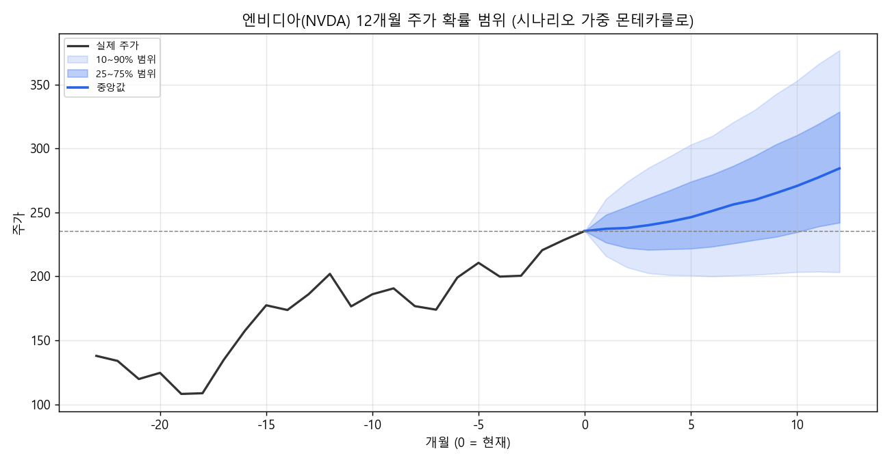

# 📈 Stock Dynamics eXtended (sdx) — 주식판의 운동방정식 v2

> **"주가는 가치($V$)를 향해 끌려가는 고무줄 끝의 공이다."**  
> DCF 내재가치와 감쇠진동 물리방정식을 결합하여 주가를 역산·진단하고, 시나리오 가중 몬테카를로로 "얼마나 오를 수 있는가"를 확률로 답하는 차세대 뉴로-심볼릭 주가 분석 엔진입니다.

[](https://www.python.org/)
[](LICENSE)
[]()

---

## 🏛️ 1. 핵심 원리 (The Core Philosophy)

전통적인 금융 모델은 주가를 기하 브라운 운동(랜덤워크)이나 정적인 DCF(점 추정)로만 바라봅니다.  
**주식판의 운동방정식**은 시장을 **가치($V$)라는 앵커에 고무줄로 묶여 마찰($c$)을 받으며 움직이는 동역학계**로 모델링합니다.

$$\ln P(t) = x(t), \quad \ln V(t) = u(t)$$

$$x'' = -\frac{c}{m}x' + \frac{k}{m}(u - x) + \epsilon$$

| 물리 기호 | 금융 시장의 실체 | 관찰 및 추정 지표 |
| :---: | :--- | :--- |
| **$V$ (가치)** | 고무줄의 고정점 (미래 FCF 기대의 현재가치) | 컨센서스 EPS × 적정 배수, 2단계 역DCF |
| **$k$ (복원력)** | 괴리($V-P$)를 좁히려는 저평가 매수세 | 밸류에이션 밴드 회귀 속도 |
| **$c$ (마찰)** | 속도에 비례해 커지는 매도압력 | 차익실현, 유동성 한계, 기관 포트폴리오 비중 상한 |
| **$m$ (관성)** | 주가의 방향 전환 저항력 ($m=1$ 정규화) | 시가총액, 수급 전환 지연 |
| **$\epsilon$ (노이즈)** | 단기 뉴스 및 수급 충격 | Student-$t$ 분포 ($df=4$) 두꺼운 꼬리 반영 |

### ⚡ 3대 불변 법칙
1. **방향은 실적 기대 상향 속도($V' = g$)가 정한다:** 주가를 미는 것은 실적의 '크기'가 아니라 **'기대가 오르는 속도'**입니다. 실적이 사상 최대여도 컨센서스 상향이 멈추면($V'=0$) 추가 상승 동력은 소멸합니다.
2. **영원한 격차 법칙 ($\Delta = \frac{c \cdot g}{k}$):** 실적이 가파르게 상향($g \gg 0$)되는 동안에는 주가가 아무리 따라붙어도 마찰($c$)로 인해 구조적으로 항상 실적 뒤편에 처져서 **'싸 보이는 상태'**가 지속됩니다.
3. **감쇠비 $\zeta = \frac{c}{2\sqrt{k}}$에 따른 4대 국면:**
   - $\zeta < 0$: **마찰 소멸 (버블/투매)** — 추세가 스스로 가속 (단기 되돌림 극도로 위험)
   - $\zeta < 0.7$: **과열 후 조정형** — 가치보다 크게 넘쳤다 되돌아옴 (오버슈트 발생)
   - $0.7 \le \zeta \le 1.3$: **균형 수렴형** — 약간 출렁이며 가치로 가장 합리적 수렴
   - $\zeta > 1.3$: **느린 추격형** — 호재에도 천천히 따라가는 대형주 국면

---

## 🚀 2. v2 혁신 기능 (v1 대비 개선점)

| 항목 | v1 (레거시) | v2 (`sdx.py`) |
| :--- | :--- | :--- |
| **공간 변환** | 절대 가격 수준 회귀 (스케일 왜곡) | **로그가격($\ln P$) 공간 적합** (10배 급등주도 안정적) |
| **추정 안정성** | 무제약 OLS (불안정 파라미터 폭주) | **이산 안정영역 제약 + 릿지(Ridge) 수축** (데이터 부족 시 보수적 수축) |
| **노이즈 모델** | 표준 정규분포 (급등락 과소평가) | **Student-$t$ ($df=4$) 팻 테일(Fat-tail) 충격** |
| **예측 방식** | 단일 경로 점 추정 | **시나리오 가중 몬테카를로 (10/25/50/75/90% 확률 콘)** |
| **핵심 출력** | 12개월 뒤 위치만 제시 | **경로 중 최대 상승(Max Gain) + 피크아웃 시점 분리 제시** |
| **자기 검증** | 미검증 뇌피셜 출력 | **워크포워드 백테스트 (CRPS, 80% 구간 적중률 vs 랜덤워크·모멘텀)** |

---

## 📊 3. 시각화 예시 (12개월 확률 콘)

시나리오 가중 몬테카를로(6,000회)를 통해 단일 점 추정이 아닌 **입체적 확률 콘(Probability Cone)**을 도출합니다.



---

## 🛠️ 4. 빠른 시작 (Quick Start)

### 설치 (Requirements)
```bash
git clone https://github.com/sunjongos/stock-dynamics-dcf.git
cd stock-dynamics-dcf
pip install -r requirements.txt
```

### CLI 명령어 요약

#### ① 역DCF (`rdcf`) — 현재 주가가 정당화하는 목표 EPS 산출
```bash
python scripts/sdx.py rdcf --price 235.48 --eps1 15.91 --years 4 --eps-cases 18 22 28 35 --beta 2.22
```
* **결과:** 현재가가 요구하는 4년차 EPS 역산 및 CAPM(고베타) 할인율 기준 적정가 민감도 표 도출.

#### ② 동역학 진단 (`fit`) — 마찰 $c$, 복원력 $k$, 감쇠비 $\zeta$ 추정
```bash
python scripts/sdx.py fit --prices assets/sample_prices.csv --values assets/sample_values.csv
```
* **결과:** 부트스트랩(10/50/90%) 신뢰구간, 롤링 $\zeta$ 안정성, 국면 판정, 가치 괴리율 출력.

#### ③ 몬테카를로 시뮬레이션 (`mc`) — 3/6/12개월 확률 분포 및 팬 차트
```bash
python scripts/sdx.py mc --prices assets/sample_prices.csv --v0 328.7 --g 8.5 --v-now 235.5 \
  --scenario "강세확장|0.35|to:420@12" \
  --scenario "컨센서스수렴|0.50|to:328.7@12" \
  --scenario "매크로조정|0.15|to:180@9" \
  --plot assets/fan.png --title "12개월 주가 확률 콘"
```

#### ④ 워크포워드 백테스트 (`backtest`) — 모델 예측력 자기검증
```bash
python scripts/sdx.py backtest --prices assets/sample_prices.csv --values assets/sample_values.csv --min-train 24 --h 6
```
* **결과:** 랜덤워크(RW) 및 모멘텀(MOM) 기준선 대비 연속순위확률점수(CRPS) 개선도 정밀 판별.

---

## 📂 5. 디렉터리 구조

```
stock-dynamics-dcf/
├── SKILL.md                 # Antigravity/Cursor AGI 전용 에이전트 스킬 명세서
├── README.md                # 레포지토리 메인 문서
├── requirements.txt         # 의존 패키지 목록 (numpy, scipy, matplotlib, yfinance)
├── scripts/
│   ├── sdx.py               # [핵심] v2 통합 엔진 (rdcf, fit, mc, backtest)
│   ├── dcf.py               # v1 레거시 전통 DCF 및 할인율 민감도
│   ├── dynamics.py          # v1 레거시 1차원 가격 레벨 동역학 분석
│   └── fetch_prices.py      # yfinance 기반 실시간 월간 주가 시계열 수집기
├── references/
│   ├── theory.md            # 감쇠진동 물리 모델의 수학적 증명 및 미분방정식 유도
│   └── report-template.md   # 분석 보고서 표준 템플릿
└── assets/
    ├── sample_prices.csv    # 샘플 주가 시계열 데이터
    ├── sample_values.csv    # 샘플 컨센서스 가치 시계열 데이터
    └── nvda_fan.png         # 엔비디아 12개월 주가 확률 콘 차트
```

---

## ⚖️ License & Disclaimer

- 본 소프트웨어는 MIT 라이선스에 따라 자유롭게 수정 및 배포가 가능합니다.
- **투자 면책조항:** 본 모델의 산출물과 시뮬레이션 결과는 수리 통계 모형에 기반한 가치 진단 및 확률 분석 참고 자료일 뿐이며, 특정 종목에 대한 매수·매도 추천이나 금융 투자 권유가 아닙니다. 모든 투자 판단과 책임은 사용자 본인에게 있습니다.
